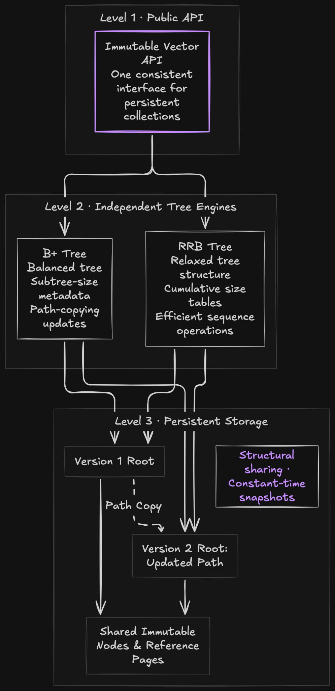

# Architecture overview

ArrayForge exposes one immutable vector contract backed by two independent persistent tree implementations.

## Main parts

1. **Vector API** — indexed access, sequence edits, conversion, snapshots, iteration and transactions.
2. **B+ engine** — balanced leaf and branch occupancy, subtree-size metadata and path-copying updates.
3. **RRB engine** — relaxed subtree sizes, cumulative size tables and path-copying sequence operations.
4. **Transaction builder** — stages indexed writes and flushes them through `setMany()` before structural edits or commit.
5. **Benchmark tooling** — shared workloads, Node measurement, V8 allocation sampling and a browser benchmark page.

The B+ and RRB engines have separate node representations, construction paths, navigation, mutation and deletion algorithms, iterators and structural validators. They share the `PersistentTreeVector<T>` contract, not a common tree implementation.

## Persistent versions

A vector points to an immutable root. An update creates new pages and nodes along the affected path and reuses untouched subtrees. Older versions continue to read from their original roots.

Immutability applies to the collection's storage structure. Values in reference pages are ordinary JavaScript values: storing an object does not freeze or clone that object.

## Pages and metadata

The current implementation stores arbitrary JavaScript values in bounded reference pages. Branch nodes keep child references and subtree-size metadata used for indexed navigation. Regular branches also cache a uniform child span so navigation can use arithmetic descent; ragged branches use cumulative-size lookup.

The current package does not include typed-array numeric collections, bit-packed pages or a sparse/tombstone backend. Those were explored in the broader design but are not part of this implementation.

## Transactions

A builder holds the current immutable vector plus a map of pending point writes. `set()` stages a write. Before an insertion or deletion, pending writes are flushed through `setMany()` so the call order is preserved. `commit()` flushes remaining writes and returns the resulting vector; `rollback()` discards the unpublished work.

`transact()` wraps the same builder lifecycle in a synchronous callback. If the callback throws—or returns a thenable—the transaction is rolled back and the error is rethrown. The original vector is never modified.
